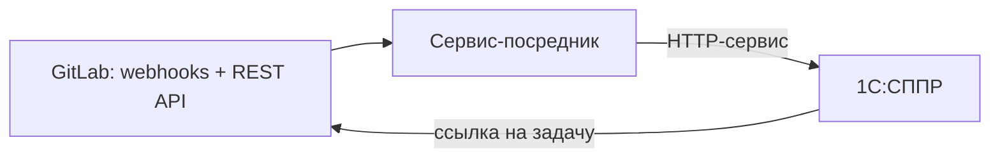

# Интеграция с 1С:СППР

> **Архитектура, не реализация.** Схема не согласована с заказчиком (требование 14 не выполнено).

## Идея
GitLab отдаёт события через вебхуки в сервис-посредник; тот через API 1С:СППР связывает спецификации, задачи, ошибки, коммиты и релизы.

## Сущности и поля
| Сущность СППР | Источник GitLab | Поля |
| --- | --- | --- |
| Спецификация/задача | issue | id, title, assignee, labels |
| Коммит | push event | sha, message (`#N:` → номер задачи), author |
| MR | merge_request event | iid, state, pipeline status |
| Ошибка качества | Sonar issue | rule, severity, file |
| Выпуск | tag / release | `vX.Y.Z`, ссылка на артефакт |

## Связь
Номер задачи в сообщении коммита (`#123:`) — ключ связи. Вебхуки: push, merge request, pipeline, tag push, issue.

## Открытые вопросы к заказчику
Какие объекты СППР первичны; доступен ли HTTP-сервис СППР; аутентификация; требования к хранению истории.
