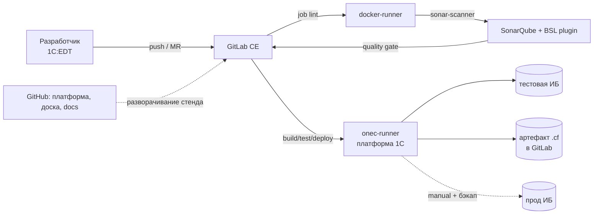

# Архитектура

> Статус: схема описывает **проектируемый** стенд. Реально поднятое отмечено в `requirements-status.md`; до подтверждения людьми считаем «описано, не запущено».

## Компоненты

| Компонент | Где | Назначение |
| --- | --- | --- |
| GitLab CE | Docker на VPS | репозиторий конфигурации (формат EDT), MR, pipeline, реестр артефактов |
| docker-runner (тег `docker`) | Docker на VPS | стадия `lint`, не требует платформы 1С |
| onec-runner (тег `onec`) | shell на VPS с платформой 1С | `build`, `test`, `deploy-*` |
| SonarQube + Postgres | Docker на VPS | статический анализ, quality gate; плагин sonar-bsl-plugin-community |
| Платформа 1С + EDT | VPS (лицензия владельца) | сборка `.cf`, тестовая ИБ |
| GitHub | облако | репозиторий платформы (инфраструктура, документы), доска задач |

## Схема

## Потоки данных
1. Разработчик пушит ветку и открывает MR → GitLab запускает pipeline.
2. `lint`: sonar-scanner отправляет исходники в SonarQube, ждёт quality gate; статус возвращается в MR.
3. `build`/`test`: onec-runner собирает `.cf` и гоняет тесты на отдельной тестовой ИБ; JUnit показывается в MR.
4. Merge в `release/*` → `artifact` + `deploy-test`. Тег `vX.Y.Z` → manual `deploy-prod`.

## Сеть и безопасность
- Наружу: 80/443 GitLab (регистрация закрыта, 2FA), Sonar только чтение демо-проекта (решение по доступности — открытый вопрос команды). Админ-порты закрыты firewall.
- Секреты — в `.env` и CI variables (masked/protected), не в git.
- Лицензия 1С привязана к машине: hostname VPS не менять (`license.md`).
